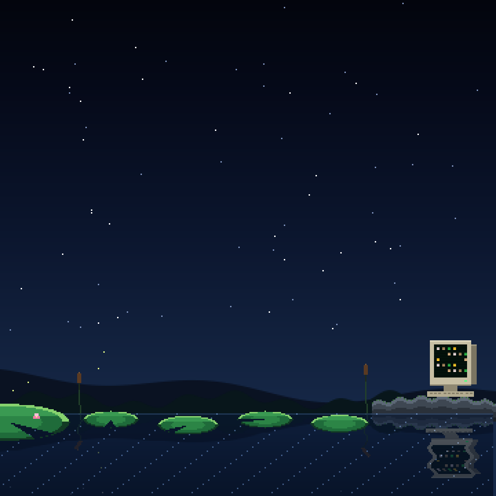

# Daybreak

**by FrogHybrid** · NODE OCCUPY Exhibition 2 (projector wall 8,640 × 2,160, two LED tables 1,600 × 1,600)

Daybreak is a rebel’s live artwork in code, made entirely with AI and stored fully onchain. It follows the journey of a machine
from first light to where he is today, sharing the milestones along the way. The piece is etched forever inside an NFT
(0xD2A3DB54Abc4F3A292bB91dBe06Da93f18A4dcB7) on the Robinhood Chain, displaying across the wall and both tables and lighting up
with every bridge crossing. Every detail was carefully thought of and carries a meaning. Take the leap for a treat 🐸

## See it
- Live: **https://daybreak-froghybrid.pages.dev**
  - one surface at a time: `?surface=projector-wall`, `?surface=table-1`, `?surface=table-2`
  - with no `?surface=`, the wall and both tables together
- The NFT: **Daybreak (DAYBREAK)**, Robinhood Chain, contract `0xD2A3DB54Abc4F3A292bB91dBe06Da93f18A4dcB7`, token 1:
  https://robinhoodchain.blockscout.com/token/0xD2A3DB54Abc4F3A292bB91dBe06Da93f18A4dcB7/instance/1

## How it works
- The whole piece is one HTML page of code, `daybreak.html`. No images, video or outside files: everything is drawn live.
- That page is stored inside the NFT itself, in 24 pieces on Robinhood Chain, with its preview picture. The art is locked:
  it can never be changed, by anyone.
- The website (`website/index.html`) asks the chain for the stored page, checks its SHA-256 fingerprint
  (`496d6984f068e9435492233cd3db710ffd5160559354e09c7ed0221f61673da7`, the same as `daybreak.html`) and plays it.
  If the chain does not answer, it plays a saved copy of the same file.
- While it plays, the piece reads real bridge crossings to Robinhood Chain and shows each one live.

## Files
- `daybreak.html`: the artwork, byte for byte the page stored in the NFT.
- `website/`: the live site's start page, security rules (`_headers`), icons and link-preview picture.
- `contract/Daybreak.sol`: the NFT's contract (source also verified on the Robinhood Chain explorer);
  `contract/picture.png`: the NFT's preview picture.

## Made with AI
FrogHybrid can't code or draw. Daybreak was made entirely with AI (Claude, by Anthropic), through many conversations.
